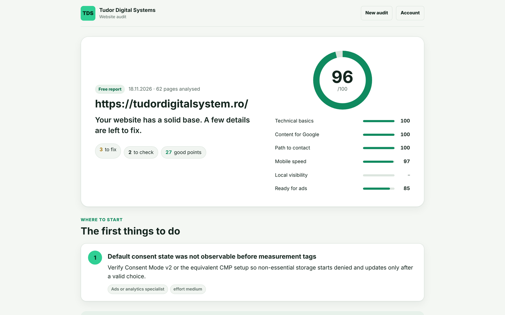
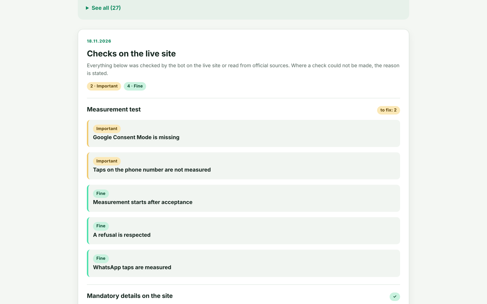
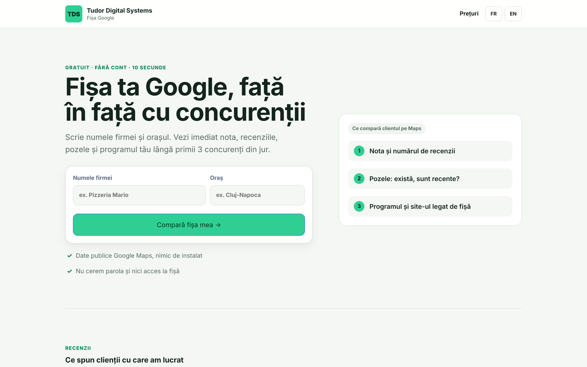
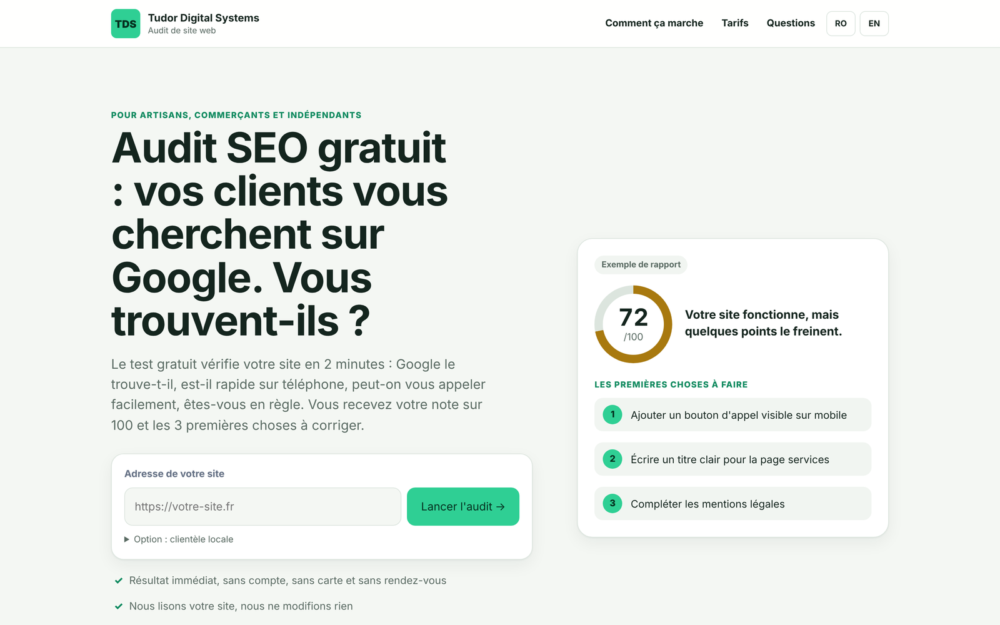

# AuditFix: website and Google visibility audits for small businesses

AuditFix is the audit platform behind [Tudor Digital Systems](https://tudordigitalsystem.ro). A business owner enters a website address and, about two minutes later, gets a score out of 100, the first three things to fix and the evidence behind every finding. It runs in production in three languages:

- Romanian and English: [audit.tudordigitalsystem.ro](https://audit.tudordigitalsystem.ro)
- French: [audit.tudordigitalsystems.fr](https://audit.tudordigitalsystems.fr)

> This repository is a showcase. The application is a commercial product and its source code is private. This page describes what the platform does and how it is built. All screenshots are taken from the live site, and the report shown is a real audit of tudordigitalsystem.ro run on 18 November 2026.


## What it does

**Free SEO audit.** The bot reads a bounded sample of the site's public pages (62 pages for the report below) and scores six areas:

| Area | What is checked |
|---|---|
| Technical basics | HTTPS and the HTTP-to-HTTPS redirect, robots.txt and an XML sitemap that really are what they claim to be, canonical tags, indexing directives, redirect chains, invalid JSON-LD, broken links |
| Content for Google | Title, meta description, H1, image alt text and text depth on the pages that answered |
| Path to contact | Forms, phone, e-mail, WhatsApp, calls to action, contact page |
| Mobile speed (lab) | LCP, CLS, TBT and FCP measured in the audit browser on a simulated mid-range phone on 4G, scored with Lighthouse's published curves and weights |
| Local visibility | Contact details, local schema and page language; only scored when local relevance is medium or high |
| Ready for ads | HTTPS, legal pages, contact paths and measurement; capped at 85 because a public crawl cannot prove conversions |

The overall score is the mean of the areas that apply. Every deduction maps to a finding in the report. Anything that cannot be verified from outside is listed under "requires manual review" and never lowers a score. When coverage is incomplete, the report says so and caps the content scores. The full rules are in [METHODOLOGY.md](METHODOLOGY.md).



**Checks on the live site.** A phone-sized browser visits the site several times: once without answering the cookie banner, then refusing, then accepting, then tapping the phone link and the WhatsApp link. At each step it records which measurement vendors received data and which cookies were set. Requests to measurement vendors are answered locally, so test visits never reach the owner's statistics. The same pass looks for the legal details a site must show (country rules for RO, FR, GB, DE and a generic EU set). This is a technical check, not legal advice.



**Free Google Business Profile check.** The owner types the business name and city. The platform reads the profile and three nearby businesses of the same primary type from the Google Places API (New) and compares rating, number of reviews, photos, opening hours and the linked website. Nothing needs to be installed and no access to the profile is requested.



**Paid audits.** The paid packages add modules that are observed or read from an official source, never estimated. Each module records how it was checked and the raw evidence. A module that cannot run is shown as "not checked" with the reason, and produces no finding.

- Search and map positions from a paid SERP API (mobile results, located at the business), never from scraping Google
- The Google Business Profile compared with three nearby competitors
- Real-visitor speed from the Chrome UX Report (75th percentile, 28 days, phone)
- A one-time, read-only reading of Search Console and Analytics; the access token is not stored
- A single labelled test message through the contact form, only with the owner's consent and proof of ownership; CAPTCHA-protected forms are never submitted
- Questions a customer would ask, put to AI assistants with web search enabled, showing whether the business is named
- Ten priorities ordered by computation (severity, impact, effort). AI may reword a finding, but reworded text is kept only if it adds no number that is not in the finding
- A re-check after 14 days that compares what was fixed, what appeared and how positions moved

Reports are available as a web page, PDF and JSON export.

## Three languages, two domains

Every public page exists in Romanian, French and English. Each language has its canonical domain (French on the .fr domain; Romanian and English on the .ro domain), with hreflang alternates, a per-domain sitemap, structured data that matches the visible FAQ, and an `llms.txt` file for AI assistants.




## How it is built

| Layer | Technology |
|---|---|
| Web app | Python, FastAPI, Jinja templates, server-rendered HTML with little JavaScript |
| Audit engine | httpx crawler, Playwright with Chromium for rendering, speed and the measurement test |
| Reports | HTML, PDF (ReportLab) and JSON exports |
| Data | SQLite with encrypted backups |
| Payments | Stripe Checkout and webhooks |
| E-mail | SMTP notifications, signed links for approving customer reviews |
| External data | Google Places API (New), Chrome UX Report API, a SERP API, Google Search Console and Analytics (read-only OAuth) |
| Hosting | Docker Compose on a VPS behind Caddy (automatic HTTPS, HSTS, security headers) |

```
Internet ──> Caddy (80/443, TLS, security headers)
               │
               ▼
          AuditFix app (FastAPI) ── holds data and secrets, read-only filesystem
               │  authenticated egress proxy
               ▼
          Chromium container ── no secrets, no data, no direct internet access
```

### Security choices

- **The crawler only reaches public websites.** Every destination is checked before the request and again at socket level: it must be a public address on a web port. The HTTP client and the browser's egress proxy connect to the exact address that was checked, so a DNS answer that changes between the check and the connection (DNS rebinding) cannot reach a private service.
- **The browser is isolated.** Chromium runs in its own container on an internal network, with no secrets and no data. Its only way out is the app's authenticated egress proxy, which applies the same public-address rule.
- **Hardened containers.** Read-only root filesystem, all Linux capabilities dropped, `no-new-privileges`, memory and process limits, health checks.
- **Accounts.** Passwords hashed with PBKDF2-SHA256 (600,000 iterations), login rate limits per IP and per account, e-mail verification and password reset with expiring tokens.
- **Privacy.** Page views are counted without cookies. The Google Ads measurement cookie is set only after the visitor accepts it. Google Places content is removed from stored reports after 30 days; only place IDs are kept.

### Quality

- More than 150 automated tests (pytest), including browser tests on a local fixture site: scoring, the measurement test, legal checks, payments, account security, reviews, structured data and the per-language URLs.
- Each release is checked by a smoke test against the running service, with an automatic rollback to the previous version if a check fails.

## About

Built and run by Tudor Bizu, software engineer and founder of Tudor Digital Systems, and a master's student at Institut Polytechnique de Paris.

- Websites, SEO and custom software: [tudordigitalsystem.ro](https://tudordigitalsystem.ro) (RO/EN) · [tudordigitalsystems.fr](https://tudordigitalsystems.fr) (FR)
- Contact: contact@tudordigitalsystem.ro
- Other projects: [MRCond](https://github.com/bizutudor/mrcond) · [pred2sched](https://github.com/bizutudor/pred2sched)
